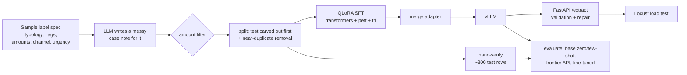

# Fine-Tuned Fraud Typology Extractor

A small open model (Qwen2.5-3B-Instruct), fine-tuned with **QLoRA**, that reads messy free-text fraud case notes
and dispute descriptions and returns structured JSON: fraud typology, red flags, amounts, channel, and urgency.
It is compared against prompting the base model and a frontier API model, then served with **vLLM** behind a
validated **FastAPI** endpoint and load-tested with **Locust**.

It plugs into the [Fraud Case Investigation Agent](https://github.com/Keerthana-2003/fraud-investigation-agent)
as its `typology_classifier` tool.

> All data is **synthetic**. No real customer, bank, or employer data is used.

**Input**

> Cust says she got a call from "the bank", they said her acct was compromised and told her to move $4,200 to a
> safe account. New payee set up same day. Now thinks it was a scam, wants $ back asap.

**Output**

```json
{"typology": "authorized_push_payment_scam",
 "red_flags": ["bank impersonation", "new payee", "social engineering call", "urgency pressure"],
 "amounts": [4200.0], "channel": "phone", "urgency": "high"}
```

## Results

<!-- TODO: replace with your numbers from results/results.md after running the notebook. -->

Hand-verified held-out test set (n = _your count_), 10 typologies.

| Model | Typology acc. | Macro-F1 | JSON validity | All-fields EM | p95 latency | Cost / 1K requests |
|---|---|---|---|---|---|---|
| Qwen2.5-3B base, zero-shot | _run eval_ | | | | | |
| Qwen2.5-3B base, few-shot | _run eval_ | | | | | |
| Frontier API (gpt-4o), few-shot | _run eval_ | | | | | |
| **Qwen2.5-3B QLoRA (this project)** | _run eval_ | | | | | |

Load test (Locust, 32 users, single _GPU_): _X_ requests/sec, p95 _X_ ms.

## Pipeline



### Data
- **Labels first, text second.** `generate_data.py` samples a label (typology, 1-4 red flags from a fixed
  vocabulary, amounts, channel, urgency), then asks a strong LLM to write a 60-150 word case note in one of six
  styles (terse call-center note, emotional customer, chat excerpt, typo-heavy, vague, formal). The label is known
  by construction.
- **Quality filter.** A note is rejected if any labeled amount is missing or any extra dollar figure appears.
- **Offline templates** (`--writer template`) produce noisy notes without an API key, for tests and extra hard examples.

### Avoiding eval contamination
- The test set is carved out **before** anything else, stratified by typology.
- Any train/val note with word 5-gram Jaccard similarity above 0.8 to a test note is removed.
- Test rows are **hand-verified** (`prepare_data.py` exports a CSV; only rows marked `verified = y` are imported).
- Prompts live in one module (`prompts.py`) shared by training, evaluation, and serving, so they can't drift.

### Training
QLoRA: 4-bit NF4 base weights with double quantization, LoRA rank 16, alpha 32, dropout 0.05, on all linear
layers; 2 epochs, LR 2e-4 cosine, effective batch 16, loss on the JSON answer only. Fits on a free T4.

### Metrics (`metrics.py`)
Typology accuracy and macro-F1, JSON validity (with invalid-JSON vs schema-error breakdown), field-level exact
match per field, all-fields exact match, red-flag set F1, latency p50/p95, and cost per 1K requests (token prices
for API models; GPU $/hour x wall time for self-hosted models).

## Quickstart

**Train and evaluate on a free GPU:** open `notebooks/train_qlora_colab.ipynb` in Google Colab (T4 runtime) and
run the cells top to bottom.

**Locally:**

```bash
make install
cp .env.example .env                 # OPENAI_API_KEY for data generation and the frontier baseline
make data-llm                        # or: make data-template (offline)
make split                           # then review data/test_to_verify.csv
make import                          # -> data/test.jsonl
pip install -r requirements-train.txt && make train && make merge   # needs a GPU
```

**Serve:**

```bash
docker compose up --build            # vLLM (GPU) on :8001 + FastAPI on :8000
curl -X POST localhost:8000/extract -H 'content-type: application/json' \
     -d '{"text": "Twelve charges under $3 at different websites overnight, card still in wallet."}'
make loadtest                        # results/locust_stats.csv
```

**Connect to the investigation agent:** set `TYPOLOGY_API_URL=http://localhost:8000` in that project's `.env`.

**Tests** (CPU only): `make test`

## Design decisions

- **Why fine-tune a 3B model at all?** Extraction into a fixed schema is narrow and high-volume. A small tuned
  model can match a frontier model on this task at a fraction of the cost and latency, and it can run inside the
  bank's network. The results table is there to test that claim, not assume it.
- **Rank 16, all linear layers.** A common starting point for structured-output tasks; rank 8 and 32 are easy to
  compare with `--rank`.
- **Controlled vocabularies** for red flags and channels make exact-match evaluation meaningful and let the API
  reject invalid outputs with Pydantic.
- **Validation + one repair retry in the API** instead of constrained decoding, so the JSON-validity metric
  reflects what the model actually learned.

## Known limitations and next steps

- Synthetic narratives are cleaner and more uniform than real case notes. Next: add adversarial and mixed-typology notes.
- Single-label typology. Next: multi-label output for cases that combine patterns.
- Compare with constrained decoding (vLLM structured outputs) and with rank/epoch sweeps.

## Project layout

```
src/typology/
  schema.py          output schema + controlled vocabularies
  prompts.py         system prompt, few-shot examples, chat formatting (shared everywhere)
  generate_data.py   label-first synthetic data (LLM or templates) + amount filter
  prepare_data.py    split, near-duplicate removal, hand-verification CSV workflow
  train_qlora.py     QLoRA SFT with transformers + peft + trl
  merge_adapter.py   merge LoRA into base weights (optional Hub push)
  metrics.py         parsing and all evaluation metrics
  evaluate.py        evaluate any OpenAI-compatible endpoint -> results table
serving/
  api.py             FastAPI /extract with validation, repair retry, timeouts
  locustfile.py      load test
notebooks/train_qlora_colab.ipynb
```

## License

MIT
